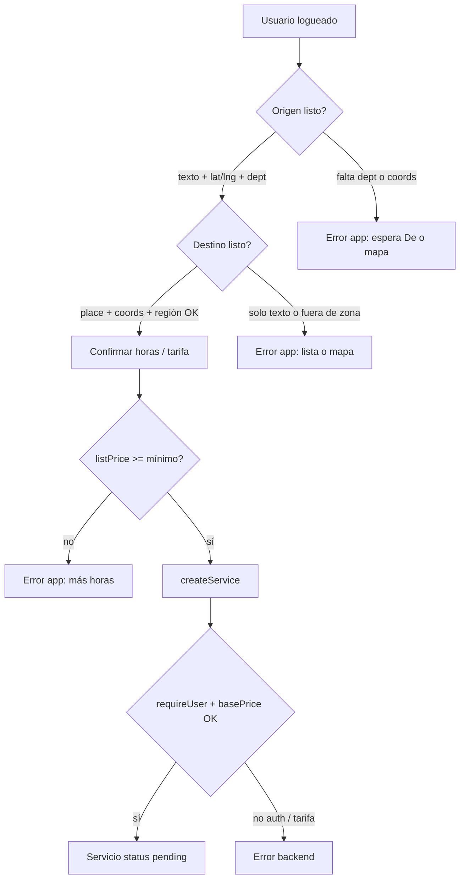

# Solicitud de servicio (cliente) — flujo y validaciones internas

Documento para **producto, QA y desarrollo**: qué hace el sistema en cada capa, qué **sí** puede bloquear un pedido y qué **no** debería bloquearlo (incluido el caso histórico de DNI/selfie).

**Código principal**

| Pieza | Archivo |
| --- | --- |
| UI y validación previa al envío | [`apps/mobile/src/screens/ClientDashboard.tsx`](../apps/mobile/src/screens/ClientDashboard.tsx) |
| Autocompletado, región, sugerencias | [`apps/mobile/src/components/AddressAutocomplete.tsx`](../apps/mobile/src/components/AddressAutocomplete.tsx) |
| Reglas Callao ↔ Lima, distancias | [`apps/mobile/src/lib/googlePlaces.ts`](../apps/mobile/src/lib/googlePlaces.ts) |
| GPS + geocodificación recojo | [`apps/mobile/src/lib/pickupLocation.ts`](../apps/mobile/src/lib/pickupLocation.ts) |
| Crear servicio (Convex) | [`packages/backend/convex/services.ts`](../packages/backend/convex/services.ts) → `createService` |
| Identidad (solo perfil) | [`packages/backend/convex/users.ts`](../packages/backend/convex/users.ts) → `submitIdentity` |
| Helper de identidad (legacy) | [`packages/backend/convex/lib/identity.ts`](../packages/backend/convex/lib/identity.ts) |

Diseño visual antiguo: [`mobile-cliente-pedir-servicio.md`](./mobile-cliente-pedir-servicio.md).

---

## Resumen: qué bloquea «Solicitar servicio»

| Validación | ¿Bloquea pedir servicio? | Dónde |
| --- | --- | --- |
| Sesión / login | **Sí** | Backend `requireUser` en `createService` |
| DNI, nombres, selfie | **No** | Ya no está en `createService` |
| Consulta RENIEC / VerificaPe al pedir | **No** | Esas APIs solo las usa el **panel admin** |
| Origen con texto + lat/lng + **departamento** | **Sí** (app) | `canContinue`, `handleSubmit` |
| Destino elegido con lat/lng (lista o mapa) | **Sí** (app) | Idem |
| Destino en departamento permitido vs recojo | **Sí** (app) | `AddressAutocomplete` + `googlePlaces` |
| Tarifa ≥ mínimo del mercado | **Sí** (app y backend) | Confirmación + `createService` |
| Viaje activo (pending, assigned, …) | **No bloquea backend**; la **home** muestra el viaje en curso | UI `activeTrip` |
| Segundo servicio pending simultáneo | **No** (hoy) | Backend no impide duplicados |

Si al enviar aparece *«Completa tu DNI, nombres y selfie…»*, el **Convex en producción** no tiene el `createService` actual → desplegar backend (ver [Despliegue](#despliegue)).

---

## Capas del sistema

```text
┌─────────────────────────────────────────────────────────────────┐
│ 1. AUTH (Convex Auth)                                           │
│    Sin sesión → mutations fallan con «No autenticado…»          │
└───────────────────────────────┬─────────────────────────────────┘
                                ▼
┌─────────────────────────────────────────────────────────────────┐
│ 2. APP MÓVIL — ClientDashboard                                  │
│    Estados compose / confirm; canContinue; handleSubmit         │
│    No lee identityComplete para habilitar el botón              │
└───────────────────────────────┬─────────────────────────────────┘
                                ▼
┌─────────────────────────────────────────────────────────────────┐
│ 3. APP — Places / GPS                                           │
│    Sugerencias, pin mapa, región destino, distancias            │
└───────────────────────────────┬─────────────────────────────────┘
                                ▼
┌─────────────────────────────────────────────────────────────────┐
│ 4. BACKEND — services.createService                             │
│    Login, tarifa mínima, normalizar ubicaciones, insert pending │
│    Sin identidad, sin validar región destino en servidor        │
└─────────────────────────────────────────────────────────────────┘
```



---

## Flujo de usuario (referencia corta)

1. **Inicio** — buscador «¿A dónde…?», recientes, bento.
2. **Introduce tu ruta** — De (GPS + geocode), A (Places o pin).
3. **Confirmar** — horas, tarifa, «Solicitar servicio».
4. **Historial** — servicio `pending`, esperar ofertas.

Estados en código: `flowStep` (`compose` | `confirm`), `addressSearchField`, `pinField` para mapa pin.

---

## Validaciones en la app (`ClientDashboard`)

### `canContinue` (pasar a confirmar)

Todas deben cumplirse:

| Campo | Regla |
| --- | --- |
| `origin` | Texto no vacío |
| `originLat`, `originLng` | Números (GPS, sugerencia o pin) |
| `department` | Texto no vacío (viene del geocode del recojo o del place) |
| `destination.address` | Texto no vacío |
| `destination.lat`, `destination.lng` | Números (obligatorio elegir sugerencia o confirmar pin) |

**No** se comprueba: `identityComplete`, DNI, selfie, `placeId`, provincia/distrito del destino.

### Auto-avance al confirmar

Al resolver destino (`onPlaceResolved` en el autocompletado), si origen ya tiene coords + departamento y destino tiene coords, la app llama `goToConfirmStep()` sin pasar por un botón «Continuar» manual.

### `handleSubmit` (antes de `createService`)

Vuelve a comprobar origen, destino, departamento, coords y `listPrice >= minServicePrice`. Mensajes típicos:

- Departamento vacío → *«Espera a que cargue tu dirección de recojo…»*
- Destino sin coords → *«Elige el destino desde la lista…»*
- Tarifa baja → mínimo de horas / precio del mercado

Luego arma el payload:

- `origin`: address, lat, lng, `countryCode`, `department`, provincia/distrito opcionales.
- `destination`: vía `toServiceLocation(destination)`.
- `extraDestinations`: paradas con address no vacía.
- `basePrice`: `serviceHours * hourlyRate` (preview en app; backend recalcula promos).

### Origen (De) — comportamiento GPS

En [`pickupLocation.ts`](../apps/mobile/src/lib/pickupLocation.ts):

1. Coordenadas lo antes posible (`readPickupCoordinates`).
2. Geocodificación inversa en segundo plano (texto + departamento).
3. `pickupResolving`: UI «Obteniendo tu ubicación…» hasta tener coords; el **departamento** puede llegar un poco después → sin dept no hay `canContinue`.

### Home con viaje activo

Si existe un servicio con `status` distinto de `finished` / `cancelled`, en `menuSection === "ciudad"` y `flowStep === "compose"` la pantalla muestra el **viaje en curso** en lugar del buscador de nuevo servicio. Es decisión de **UX**, no una validación del backend al crear otro servicio.

---

## Validaciones en autocompletado y mapa

Archivo: [`AddressAutocomplete.tsx`](../apps/mobile/src/components/AddressAutocomplete.tsx).

### Al elegir una sugerencia (`handleSelectSuggestion`)

1. `fetchPlaceDetails` (Google Places).
2. Según `regionMatchMode`:
   - **`pickup`** (recojo): `selectedPlaceMatchesRegion` — mismo departamento que filtro; si hay provincia en filtro, misma provincia.
   - **`destination`**: `selectedPlaceMatchesDestinationRegion` — mismo departamento que el recojo **o** departamento **aledaño** (hoy: **Callao ↔ Lima**). No exige misma provincia.
3. Si falla → error en rojo en el sheet (no avanza a confirmar).

Configuración de vecinos: `ADJACENT_PERU_DEPARTMENTS` en [`googlePlaces.ts`](../apps/mobile/src/lib/googlePlaces.ts).

### Búsqueda de destino

- Requiere `gpsCenter` / origen con coordenadas para bias y distancias.
- Máximo **5** sugerencias, orden por distancia cuando Places la envía.
- Lista visible cuando termina la petición (evita filas sin distancia).

### Pin en mapa (`PinPickerScreen`)

Reverse geocode al soltar el pin; mismas reglas de región al confirmar «Hecho» según sea origen o destino.

---

## Validaciones en backend (`createService`)

Handler actual en [`services.ts`](../packages/backend/convex/services.ts) (orden lógico):

| Paso | Qué hace | Error si falla |
| --- | --- | --- |
| Auth | `requireUser(ctx)` | «No autenticado: se requiere iniciar sesión.» |
| Ubicaciones | `normalizeServiceLocation` (trim address, `countryCode` default PE) | Validación de schema Convex si faltan campos requeridos del objeto |
| Mercado | `getMarketByCountry(ctx, origin.countryCode)` | Depende de catálogo de mercados |
| Tarifa | `args.basePrice < market.minServicePrice` | Mensaje con símbolo, tarifa/hora y horas mínimas |
| Paradas | `normalizeExtraDestinations` (descarta addresses vacías) | — |
| Clasificación | `resolveServiceClassification` → `app` + `mobile_app` | Solo admin si `requestChannel` phone |
| Precio final | `buildServicePricingFields` (promos por región del **origen**) | Puede subir precio catalogado al mínimo |
| Persistencia | `insert` en `services`, `status: "pending"`, `clientId: user._id` | — |

### Lo que el backend **no** valida hoy (importante para auditoría)

- Perfil de identidad (DNI, selfie, nombres).
- Que el destino esté en Lima/Callao u otra regla geográfica (solo confía en la app).
- Que el cliente no tenga ya otro servicio abierto.
- Coherencia lat/lng vs address (acepta lo que envía la app).

La función `requireClientIdentity` sigue definida en [`lib/identity.ts`](../packages/backend/convex/lib/identity.ts) pero **ningún archivo la importa**; no debe ejecutarse en producción. Si reaparece el mensaje de identidad, buscar en el deploy una versión antigua de `createService` que aún la llamaba.

---

## Identidad, DNI y APIs externas (política actual)

### Pedir un servicio

- **No** se exige identidad completa.
- **No** se llama RENIEC ni VerificaPe desde la app al solicitar.

### Pantalla «Mi información» (Configuración)

- Si `me.identityComplete !== true`, [`ClientSettingsScreen.tsx`](../apps/mobile/src/screens/ClientSettingsScreen.tsx) muestra [`ClientIdentityForm.tsx`](../apps/mobile/src/screens/ClientIdentityForm.tsx) en lugar del perfil en lectura.
- Eso **solo afecta esa pantalla**; el usuario puede pedir servicios desde la home sin pasar por ahí.
- El formulario pide DNI (8 dígitos), nombres y selfie **declarados manualmente**; usa `getDniRegistration` para evitar DNI duplicado. **No** autocompleta con RENIEC en móvil.

### Backend `submitIdentity`

Solo cuando el usuario envía el formulario de identidad:

- DNI válido, nombres no vacíos, `assertDniAvailable`, guarda `selfieStorageId`.
- Comentario en código: verificación RENIEC en **panel interno**.

### Panel admin (web)

- [`reniec.lookupDni`](../packages/backend/convex/reniec.ts) — Decolecta/RENIEC para dossier de chofer.
- [`verificape`](../packages/backend/convex/verificape.ts) — licencia por DNI.
- Uso típico: revisión de postulaciones chofer, no flujo cliente al pedir viaje.

### Chofer (registro, no «pedir servicio»)

La postulación chofer (`driverApplications`) sigue pidiendo DNI, fotos de brevete, etc., y `assertDniAvailable`. Es **otro flujo**; no es gate de `createService` del cliente.

### Comentarios desactualizados en schema

En [`schema.ts`](../packages/backend/convex/schema.ts) el comentario de `selfieStorageId` aún dice «obligatoria para pedir servicio»; el **comportamiento** lo define `createService` (sin identidad). Conviene alinear comentario en código cuando toque, no confiar solo en el schema.

---

## Tabla de auditoría rápida (grep / revisión)

| Buscar | Resultado esperado hoy |
| --- | --- |
| `requireClientIdentity(` en `packages/backend` | Solo definición en `lib/identity.ts`, **sin usos** |
| `createService` handler | Solo `requireUser`, tarifa, insert |
| `lookupDni` / `reniec` en `apps/mobile` | **Sin coincidencias** |
| `identityComplete` en `ClientDashboard` | **Sin coincidencias** |
| `identityComplete` en `ClientSettingsScreen` | Sí — gate de **Mi información** solamente |

---

## Errores habituales en pantalla

| Síntoma | Capa | Acción |
| --- | --- | --- |
| «Espera… recojo» / dept vacío | App | GPS + geocode o pin en De |
| «Elige el destino desde la lista…» | App | Tocar sugerencia o mapa |
| «El destino debe estar en Callao o Lima» | App / Places | Cambiar destino o ampliar `ADJACENT_PERU_DEPARTMENTS` |
| Tarifa mínima | App + backend | Más horas en confirmación |
| «No autenticado…» | Backend | Login |
| «Completa tu DNI…» al solicitar | Backend **viejo** | `npx convex deploy` en `packages/backend` |
| «Called by client» | Parseo error app | Actualizar app; ver mensaje real en logs |

---

## Despliegue

| Cambio | Comando |
| --- | --- |
| UI / JS móvil | `cd apps/mobile && npx eas-cli@latest update --channel preview` |
| Reglas Convex (`createService`, identidad) | `cd packages/backend && npx convex deploy` |
| Nativo (permisos, plugins) | Nueva `eas build` + APK |

Canal preview habitual: **`preview`**, runtime **`1.0.0`**.

---

## Checklist QA (pedido + identidad)

**Pedido (obligatorio)**

1. [ ] Login.
2. [ ] **Sin** completar Mi información → igual debe poder solicitar.
3. [ ] De con GPS → departamento cargado.
4. [ ] Destino desde lista → confirmar → Historial `pending`.
5. [ ] Callao → Lima permitido.
6. [ ] Solo texto en A sin seleccionar → no envía.

**Identidad (opcional, no debe bloquear 2–6)**

7. [ ] Entrar a Mi información: puede pedir formulario DNI/selfie; salir y pedir servicio sigue funcionando.
8. [ ] Tras `convex deploy`, mensaje de identidad **no** aparece en «Solicitar servicio».

---

## Archivos relacionados

| Tema | Archivo |
| --- | --- |
| Errores Convex en UI | `apps/mobile/src/lib/convexErrorMessage.ts` |
| Recientes | `apps/mobile/src/lib/recentDestinations.ts` |
| Sheet inicio | `apps/mobile/src/components/request/HomeRequestSheet.tsx` |
| Permiso ubicación | `apps/mobile/src/components/request/LocationAccessPrompt.tsx` |
| Flujo atención post-pending | [`4 RESUMEN FLUJO ATENCION.md`](./4%20RESUMEN%20FLUJO%20ATENCION.md) |
| EAS / OTA | [`eas-build-setup.md`](./eas-build-setup.md) |
