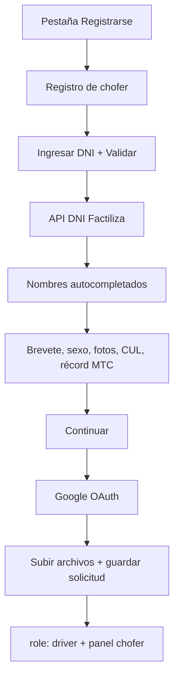

# Registro de choferes (app móvil + RENIEC)

Flujo de alta de chofer con validación de DNI vía **Factiliza** (app) y carga de
documentos en Convex Storage. Panel interno: DNI **VerificaPE**, brevete **Factiliza** (respaldo VerificaPE).

---

## Flujo en la app



1. **Registrarse** → **Registro de chofer**
2. DNI (8 dígitos) → **Validar** (RENIEC)
3. Completar brevete, categoría, sexo, fotos, CUL y récord de conductor
4. **Continuar** → **Registrarse con Google y enviar**
5. Tras enviar: pantalla *Solicitud enviada* (estado `pending`)

---

## APIs de identidad (solo Convex, nunca en la app)

```powershell
cd packages/backend
npx convex env set FACTILIZA_API_TOKEN tu_token_factiliza
npx convex env set VERIFICAPE_API_KEY tu_api_key_verificape
```

| Uso | Proveedor | Action |
| --- | --- | --- |
| App chofer — validar DNI | Factiliza | `reniec.lookupDniForDriverApp` |
| Admin — DNI (fecha nacimiento) | VerificaPE | `verificape.lookupDni` |
| Admin — brevete | Factiliza → VerificaPE si cupo agotado | `factiliza.lookupLicense` |

Endpoints:

```
GET https://api.factiliza.com/v1/dni/info/{DNI}
GET https://api.factiliza.com/v1/licencia/info/{DNI}
GET https://api.verificape.com/v2/dni/{DNI}
GET https://api.verificape.com/v2/licencia/{DNI}
Authorization: Bearer {token}
```

Código: [`reniec.ts`](../packages/backend/convex/reniec.ts), [`factiliza.ts`](../packages/backend/convex/factiliza.ts), [`verificape.ts`](../packages/backend/convex/verificape.ts)

Si `FACTILIZA_API_TOKEN` falta o Factiliza no responde, **Validar DNI** en la app permite ingreso manual (como antes con Decolecta).

---

## Inventario — qué debe entregar el chofer (alta)

Todo obligatorio en `DriverRegisterScreen.tsx`. Lo ve el admin en `DriverDossierPanel.tsx`.

- [ ] DNI (8 dígitos) validado RENIEC
- [ ] Sexo
- [ ] Zona: país, departamento, provincia, distrito
- [ ] Número de brevete
- [ ] Categoría de brevete
- [ ] Tipo de vehículo: auto o camioneta
- [ ] Brevete físico: foto anverso + reverso + selfie **o** brevete digital: PDF/imagen + selfie con impreso
- [ ] Récord de conductor (MTC) PDF
- [ ] CUL (MTPE) PDF

Tabla chofer ↔ admin: [flujo-ui-chofer-admin.md](./flujo-ui-chofer-admin.md)

---

Tabla **`driverApplications`** en Convex:

| Campo | Origen |
| --- | --- |
| `dni`, nombres | RENIEC |
| `licenseNumber`, `licenseCategory` | Formulario |
| `sex` | M / F |
| `licensePhotoIds` | Fotos brevete (Storage) |
| `culPdfId` | PDF CUL — [obtener en gob.pe](https://www.gob.pe/47089-obtener-tu-certificado-unico-laboral-cul) |
| `conductorRecordPdfId` | PDF récord de conductor — [MTC](https://recordconductor.mtc.gob.pe/) |
| `status` | `approved` (activa perfil chofer al instante) |

Al enviar la solicitud se crea el perfil en **`drivers`**, se asigna
**`users.role = "driver"`** y la app muestra el panel para **atender viajes**.

---

## Perfiles en la app móvil

| Registro | `users.role` | Vista |
| --- | --- | --- |
| Cliente (Google en Registrarse) | `client` | Solicitar chofer |
| Chofer (formulario + Google) | `driver` | Atender viajes |
| Login normal | según rol guardado | Cliente o chofer |

---

## Aprobar choferes (manual por ahora)

1. Admin → **Choferes** (solicitudes pendientes aparecen aunque aún no exista perfil `drivers`)
2. O [Dashboard Convex → driverApplications](https://dashboard.convex.dev/d/lovable-kudu-343)
3. En admin: **Aprobar** crea el perfil en `drivers` automáticamente

---

## Documentos relacionados

- [flujo-google-auth.md](./flujo-google-auth.md)
- [convex-google-auth.md](./convex-google-auth.md)
